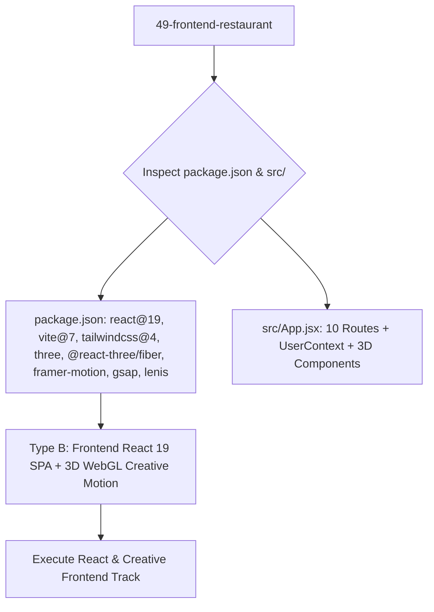

# Project Type Pre-Check: 49-Frontend-Restaurant

## Step 0 Pre-Check Analysis

- **Detected Track**: **Track B: Frontend Only (Modern React 19 Single Page Application with 3D WebGL & Creative Motion)**
- **Project Root**: `/Users/avishjain/avishjain9-repos/49-frontend-restaurant`
- **Application Directory**: Root repository structure with Vite 7 and React 19
- **Primary Domain**: Gourmet culinary community, restaurant storytelling, and blog platform integrating Three.js 3D WebGL scenes, Lenis smooth scrolling, GSAP magnetic cursor physics, and Framer Motion page transitions.

### Evidence Matrix

| Evidence Factor | Codebase Artifact | Concrete Findings | Verdict |
|---|---|---|---|
| **Package Dependencies** | `package.json` | `react@^19.2.0`, `vite@^7.3.1`, `@react-three/fiber@^9.5.0`, `three@^0.183.1`, `framer-motion@^12.34.3`, `gsap@^3.14.2`, `@studio-freight/lenis@^1.0.42` | Next-generation React 19 application featuring 3D WebGL rendering and physics-based motion. |
| **Backend Code** | Entire Repository | Client-only codebase connecting to external REST APIs via `src/utils/api.js`. No local server runtime. | **Frontend Track**. |
| **State Layer** | `src/context/UserContext.jsx` | React Context API with LocalStorage user hydration. | Native React State. |
| **Client Routing** | `src/App.jsx` | `react-router-dom@^7.13.0` handling 10 distinct culinary routes. | Modern SPA Routing. |
