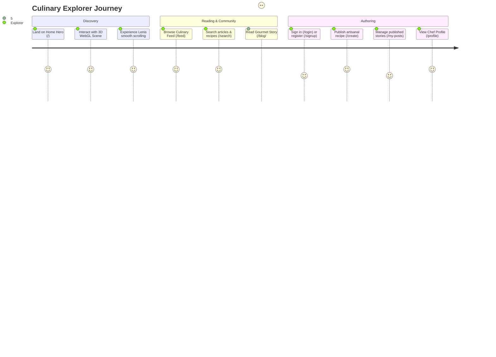

# Full Project Analysis: Gourmet Restaurant & Culinary Hub

## 0.1 What the Project Is

**Gourmet Restaurant & Culinary Hub** is an artisanal culinary publication and restaurant experience platform built with React 19, Vite 7, and Tailwind CSS 4. It blurs the line between traditional editorial websites and interactive creative applications by fusing Three.js 3D WebGL scenes, inertia-based Lenis smooth scrolling, physics-based GSAP magnetic cursor tracking, and fluid Framer Motion page transitions.

### Main User Journeys

---

## 0.2 Master Feature Inventory & Traces

### F1: Three.js 3D WebGL Interactive Canvas (`src/components/scene3d.jsx`)
- **Trace**: Uses `@react-three/fiber` and `@react-three/drei` to render lighting, shadows, and interactive 3D culinary models directly onto an HTML5 WebGL canvas.

### F2: Physics-Based Magnetic Cursor & Trailing Glow (`src/components/magnetic.jsx`, `cursor.jsx`)
- **Trace**: Uses GSAP (`gsap.to`) to compute mouse proximity vectors, pulling interactive button elements toward the cursor with elastic spring physics.

### F3: Inertia-Based Smooth Scrolling (`src/components/smoothscroll.jsx`)
- **Trace**: Integrates `@studio-freight/lenis` inside a `requestAnimationFrame` loop, normalizing wheel delta and scroll momentum across platforms.

### F4: Global Authentication & User Session (`src/context/UserContext.jsx`)
- **Trace**: React Context storing user JWT, avatar, and profile with automatic synchronization to browser `localStorage`.

### F5: Rich Culinary Editorial Feed & Detail View (`src/pages/feed.jsx`, `blogdetail.jsx`)
- **Trace**: Queries backend API via `src/utils/api.js`, rendering categorized recipe cards, reading duration estimates, and author credits.

### F6: Artisanal Recipe Creation Studio (`src/pages/createblog.jsx`)
- **Trace**: Multi-field authoring form with live banner preview, rich text body formatting, ingredient tag chips, and API POST submission.

---

## 0.3 Final Inventory Counts

| Metric | Count | Reference |
|---|---|---|
| **React Pages** | 9 | `home.jsx`, `feed.jsx`, `blogdetail.jsx`, `createblog.jsx`, `profile.jsx`, `login.jsx`, `signup.jsx`, `myposts.jsx`, `search.jsx` |
| **Interactive UI Components** | 8 | `scene3d.jsx`, `magnetic.jsx`, `cursor.jsx`, `smoothscroll.jsx`, `pagewrapper.jsx`, `navbar.jsx`, `search.jsx` |
| **Application Routes** | 10 | Declared in `src/App.jsx` using React Router v7 |
| **Dependencies** | 19 | Modern React 19, Three.js, GSAP, Framer Motion, Lenis, Vite 7 |
