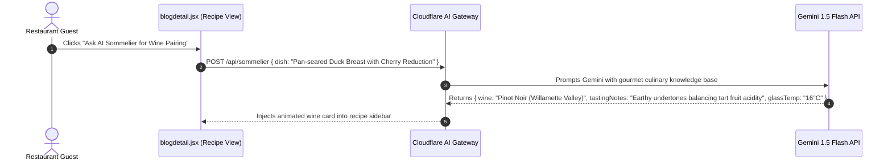

# AI Integration Analysis: Gourmet Restaurant Hub

## Current Status: No AI Integration

The repository contains **No AI integration**.

---

## Architectural Blueprint: AI Sommelier & Wine Pairing Assistant

