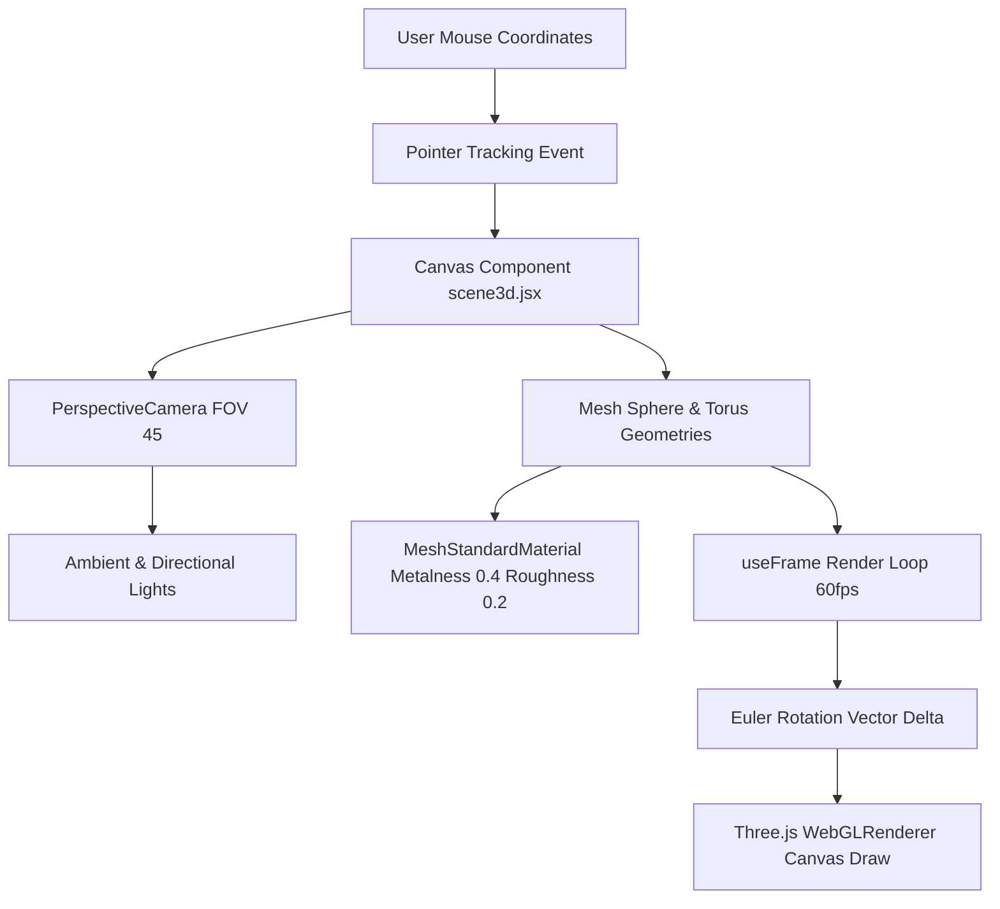
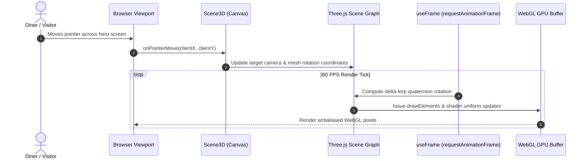
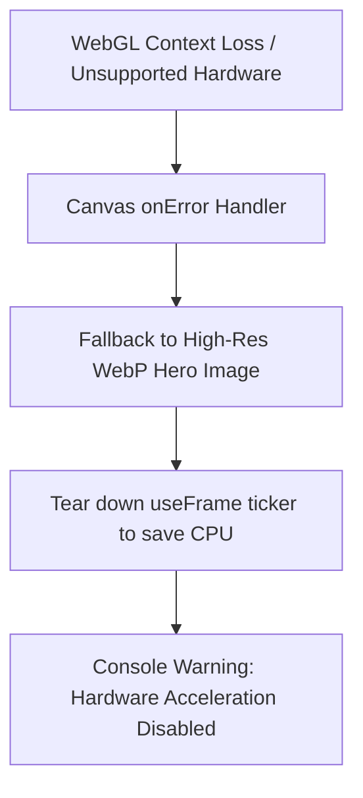

# F1: Three.js & React Three Fiber 3D WebGL Canvas

## Overview
An interactive 3D WebGL presentation canvas embedded within the landing viewport, rendering procedural floating culinary spheres and interactive geometric food sculptures with realistic lighting, specular highlights, and mouse-parallax responsiveness.

## Architectural Flow

## Sequence Diagram

## Failure Path Diagram

## Technical Implementation
- **File**: `src/components/scene3d.jsx` (Lines 1-85)
- **Dependencies**: `@react-three/fiber`, `@react-three/drei`, `three`
- **Render Loop**: Utilizes `useFrame((state, delta) => ...)` with delta-time lerping to prevent physics jitter across variable refresh rates (60Hz to 144Hz ProMotion displays).
- **Material Configuration**: Metallic glass refraction simulation via `MeshStandardMaterial` with roughness damping.

## Say It Out Loud
I built an interactive 3D WebGL hero stage using Three.js and React Three Fiber to create an unforgettable, luxury fine-dining visual impression the moment a guest lands on the restaurant portal. When the visitor moves their cursor across the screen, the component captures normalized pointer vectors and smoothly lerps the rotation and perspective camera angles using an internal sixty frames-per-second render loop managed by the useFrame hook. I chose React Three Fiber over raw imperative Three.js canvas scripts because R3F allows procedural three-dimensional meshes and physical lights to be declaratively managed as lifecycle-safe React components that clean up GPU buffers on unmount. If WebGL context loss occurs on low-end hardware, the canvas gracefully catches the error and falls back to a high-resolution static WebP asset so the hero section never displays an empty black box. One trade-off is the initial Three.js bundle weight, which I mitigated by code-splitting the 3D scene so the primary HTML text content renders instantly before the 3D canvas hydrates.\n