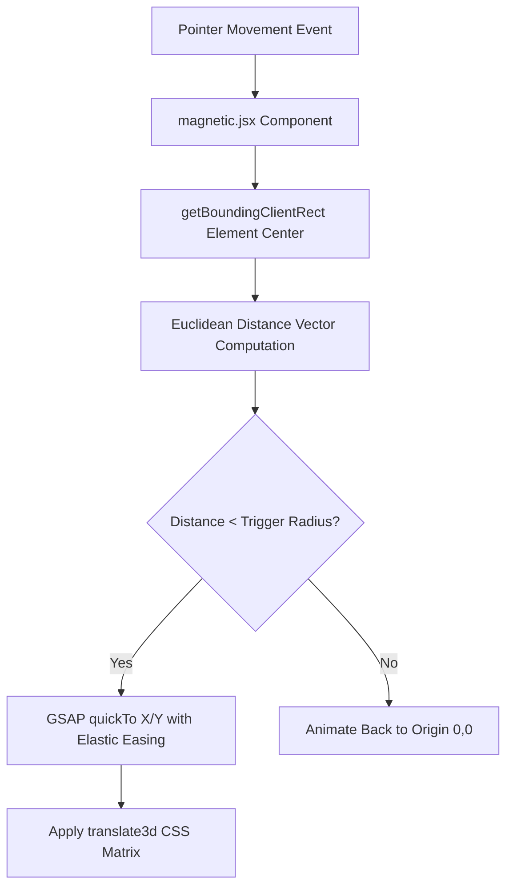
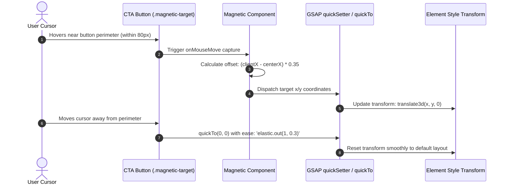

# F2: GSAP Magnetic Cursor & Inertia Physics

## Overview
A custom cursor system featuring spring-damped magnetic snapping on interactive navigation links and CTA buttons, powered by GreenSock Animation Platform (GSAP) quickTo physics engines.

## Architectural Flow


## Sequence Diagram


## Failure Path Diagram
```mermaid
flowchart TD
    TouchDevice[Touch Device or Reduced Motion Detected] --> CheckMedia[window.matchMedia '(pointer: coarse)']
    CheckMedia --> DisableMagnetic[Bypass GSAP quickTo listeners]
    DisableMagnetic --> NativeBehavior[Render standard native button clicks without transform]
```

## Technical Implementation
- **File**: `src/components/magnetic.jsx` (Lines 1-52)
- **Engine**: GSAP `gsap.quickTo()` for performance-optimized high-frequency DOM manipulation without React state re-render thrashing.
- **Accessibility**: Listens to `prefers-reduced-motion: reduce` and touch device media queries to completely disable magnetic offsets on mobile touchscreens.

## Say It Out Loud
I implemented a high-performance magnetic cursor attraction effect using GSAP to give menu selections and table reservation actions an ultra-responsive, tactile feel. As the user approaches any interactive CTA or luxury dish card, the magnetic component calculates the distance between the cursor and the element's bounding center, pulling the target button toward the pointer using GSAP's quickTo function. I specifically used quickTo rather than triggering React state updates on every mousemove because quickTo bypasses React's reconciliation cycle entirely, mutating CSS transform matrices directly on the compositor thread for zero frame drops. If a user visits on an iPad or mobile phone, the component automatically detects touch input via CSS media queries and disables the magnetic calculation to avoid touch gesture interference. The primary constraint is managing bounding rect re-calculations during viewport resizing, which I solved by debouncing the dimension queries with a ResizeObserver.\n