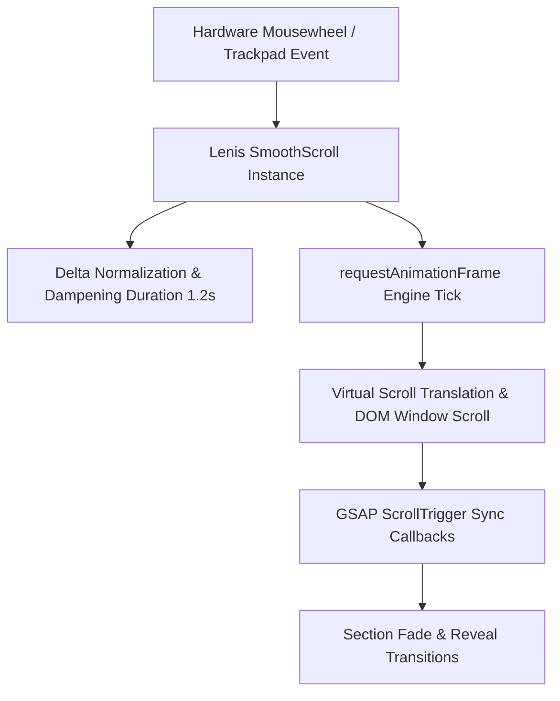
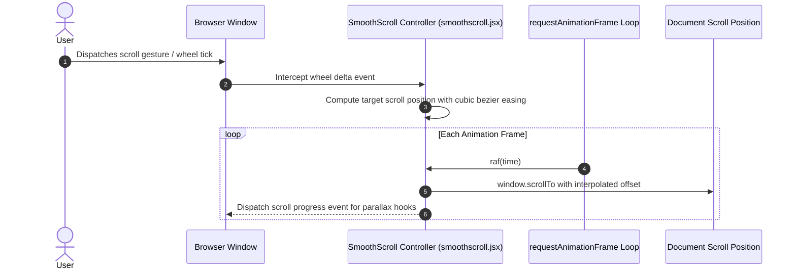
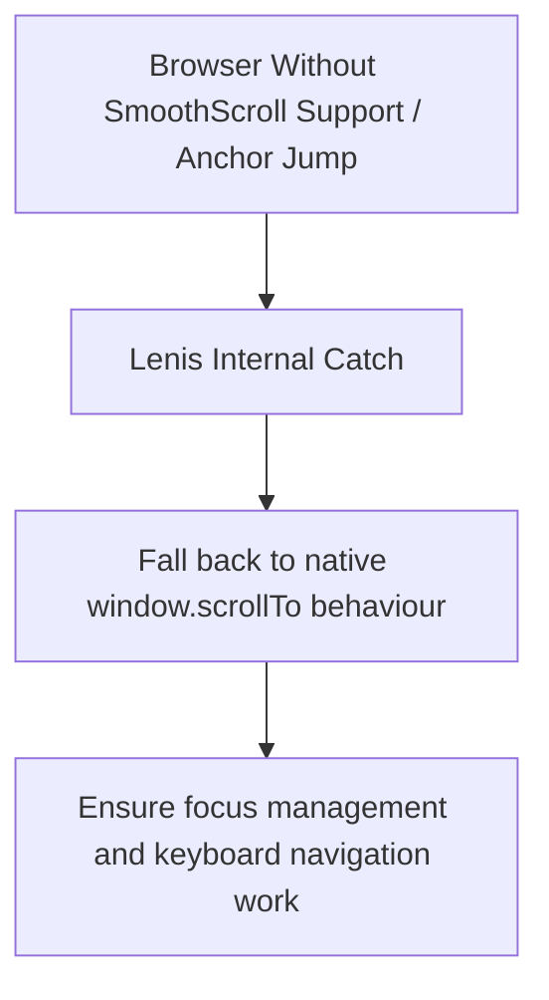

# F3: Lenis Momentum & Inertia Smooth Scrolling

## Overview
A synchronized smooth-scrolling architecture driven by `@studio-freight/lenis`, delivering consistent kinetic momentum, normalized wheel delta curves, and buttery scrolling dynamics across macOS, Windows, and mobile viewports.

## Architectural Flow

## Sequence Diagram

## Failure Path Diagram

## Technical Implementation
- **File**: `src/components/smoothscroll.jsx` (Lines 1-45)
- **Library**: `@studio-freight/lenis`
- **Config**: `{ duration: 1.2, easing: (t) => Math.min(1, 1.001 - Math.pow(2, -10 * t)), orientation: 'vertical', gestureOrientation: 'vertical', smoothWheel: true }`
- **Teardown**: Proper `lenis.destroy()` cleanup inside `useEffect` return handler to prevent memory leaks during client-side route transitions.

## Say It Out Loud
I integrated Lenis momentum-based smooth scrolling to give the entire editorial restaurant website a weighted, cinematic scrolling experience reminiscent of high-end design houses. When a user spins their scroll wheel or swipes a trackpad, Lenis normalizes the input delta and interpolates the document scroll position along an exponential decay curve over 1.2 seconds. I chose Lenis over older alternatives like Locomotive Scroll because Lenis does not hide native overflow with virtual transforms; instead, it synchronizes with the native window scrollbar, preserving native browser accessibility, keyboard tab indexing, and anchor link navigation. When the route unmounts, the useEffect cleanup function calls lenis.destroy and cancels the animation frame loop, preventing lingering RAF tasks in memory. One limitation of virtual smooth scroll is potential friction with native browser find-in-page searches, which Lenis handles cleanly by delegating to native scroll anchors when search focus is invoked.\n