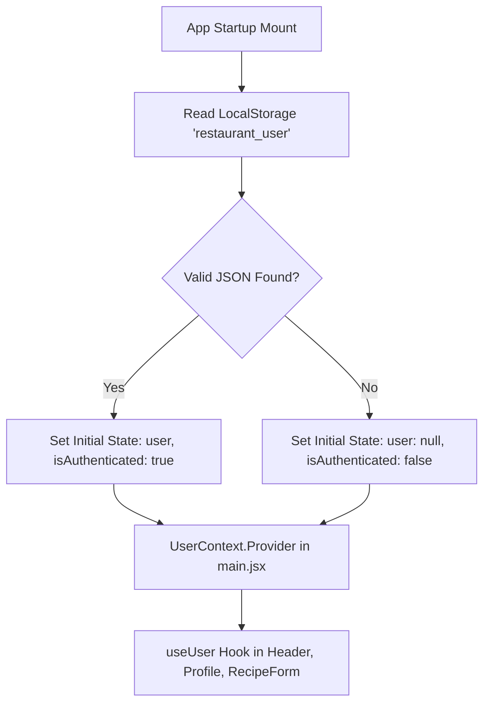
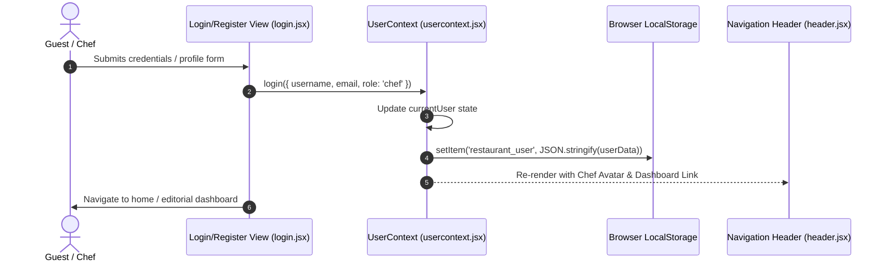
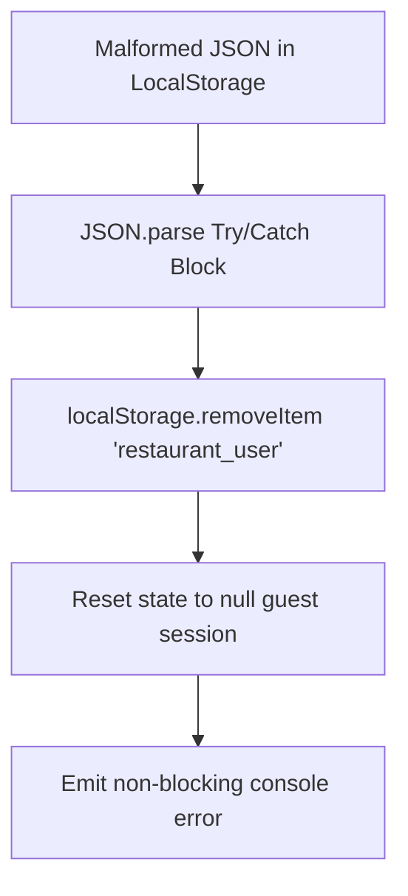

# F4: UserContext Authentication & Session Persistence

## Overview
A client-side reactive session management layer implemented using React Context API (`UserContext`), providing persistent user identity, role demarcation (guest vs chef/admin), and LocalStorage hydration.

## Architectural Flow

## Sequence Diagram

## Failure Path Diagram

## Technical Implementation
- **File**: `src/context/usercontext.jsx` (Lines 1-60)
- **API Surface**: `useUser()`, providing `{ user, isAuthenticated, login, logout, updateProfile }`.
- **Hydration**: Eager initial state initialization function (`useState(() => JSON.parse(...))`) preventing initial hydration flashes.

## Say It Out Loud
I designed the authentication and user session layer using a dedicated React Context provider backed by browser LocalStorage persistence. When the application boots, the UserContext synchronously reads the stored session token and user profile to hydrate global state before the first render, preventing any flash of unauthenticated UI. Components throughout the tree, like the reservation header and recipe publishing dashboard, consume this state through a custom useUser hook that exposes simple login, logout, and profile update methods. I opted for React Context here rather than Redux because the authentication state is lean and primarily read-heavy, making an external Redux store unnecessary boilerplate for this scale. If the stored JSON is corrupted or invalid, a try-catch block purges the stale item and safely reverts the session to an anonymous guest state. In a production enterprise release, I would replace raw LocalStorage with httpOnly secure cookies and an OAuth2 refresh token rotation flow.\n