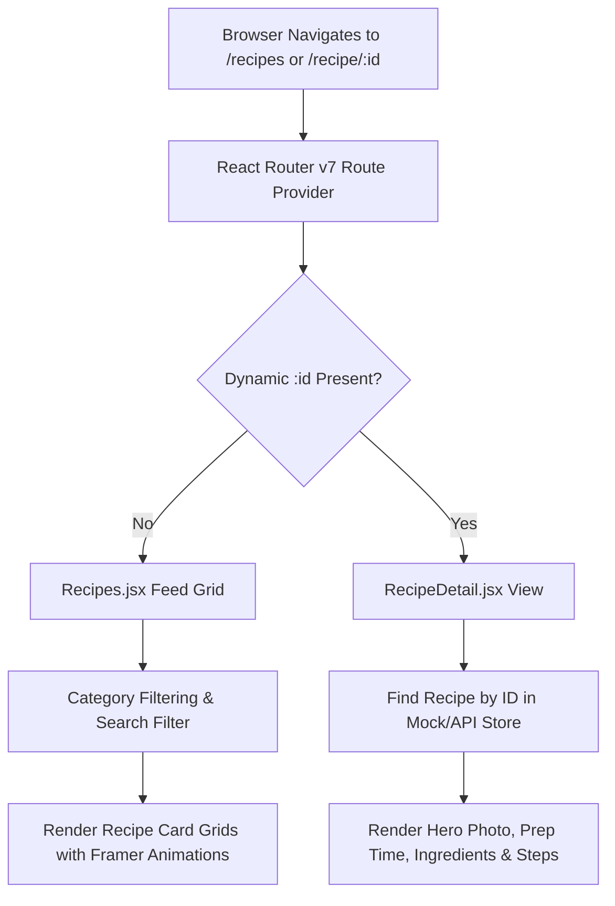
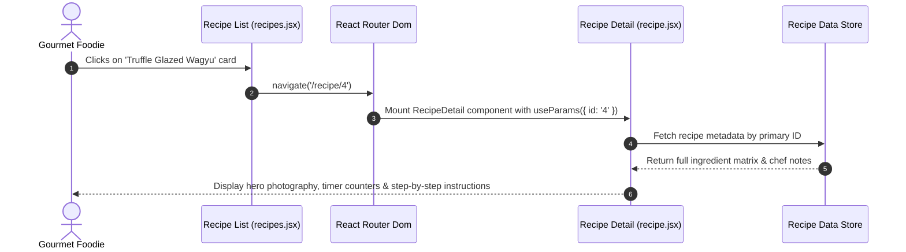
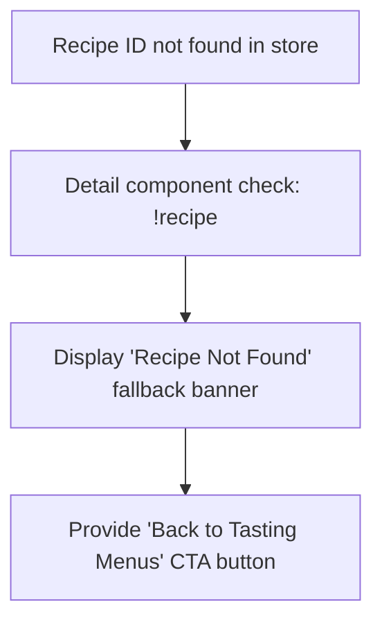

# F5: Culinary Editorial Feed & Recipe Detail Routing

## Overview
A dynamic content catalog and detail routing system built on React Router v7, rendering curated Michelin-tier recipes, seasonal tasting menus, and ingredient breakdown matrices.

## Architectural Flow

## Sequence Diagram

## Failure Path Diagram

## Technical Implementation
- **Files**: `src/views/recipes.jsx`, `src/views/recipe.jsx`, `src/views/home.jsx`
- **Routing**: `react-router-dom` v7 with declarative `<Routes>` and `<Route path="/recipe/:id" element={<RecipeDetail />} />`.
- **Layout & Typography**: Tailwind CSS 4 utility grid with responsive breakpoints (`grid-cols-1 md:grid-cols-2 lg:grid-cols-3`).

## Say It Out Loud
I built the culinary editorial feed and deep-linked recipe detail system using React Router v7 to showcase fine dining recipes with magazine-quality layout typography. When a user explores the catalogue and clicks on a tasting dish, React Router navigates to the parameterized recipe ID route without a full page reload, while the recipe component extracts the URL parameter to render the specific prep time, ingredient ratios, and plating instructions. I selected React Router v7 for its clean hooks-based routing model and native support for parameterized path matching. If an invalid or non-existent recipe ID is entered in the URL, the component intercepts the null result and renders an elegant fallback screen with a direct button back to the catalog rather than crashing the view. An immediate enhancement would be adding server-side rendering or static pre-rendering for recipe pages so that search engine crawlers can index the rich culinary recipes for SEO.\n