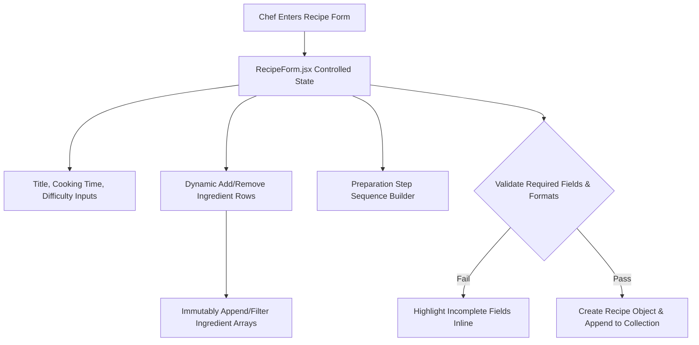
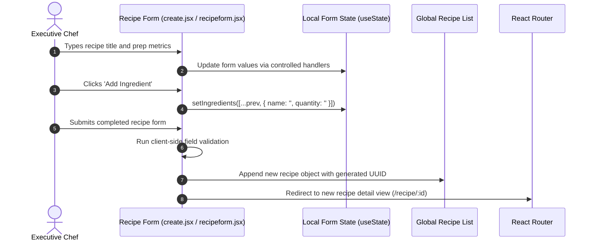
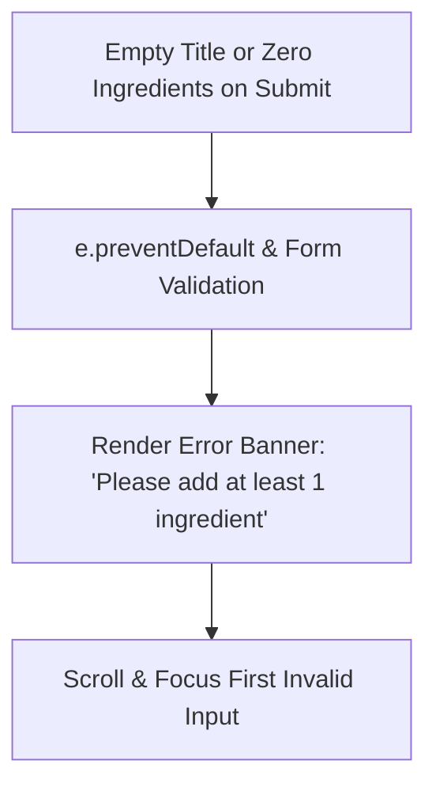

# F6: Interactive Recipe Publishing & Creation Studio

## Overview
A dynamic multi-field form studio allowing authenticated culinary chefs to draft, validate, and publish custom culinary recipes with interactive ingredient list builders, step reordering, and instant client-side preview.

## Architectural Flow

## Sequence Diagram

## Failure Path Diagram

## Technical Implementation
- **File**: `src/views/create.jsx`, `src/components/recipeform.jsx`
- **State Pattern**: Controlled React inputs with immutable array operations for dynamic step and ingredient rows (`[...items, newItem]`).
- **Data Model**: Structured recipe schema containing `id`, `title`, `author`, `prepTime`, `cookTime`, `ingredients[]`, `steps[]`, and `category`.

## Say It Out Loud
I engineered the recipe creation studio as an interactive form workspace where chefs can compose complex culinary recipes with dynamic lists of ingredients and cooking steps. As the chef drafts their dish, the component maintains controlled state for nested arrays, allowing items to be added, edited, or removed immutably without side effects. I implemented standard React controlled components rather than an external form library because the schema requirements were straightforward and maintaining native React state kept our bundle lean without adding third-party dependencies. If a user attempts to submit the form without entering required details like cooking duration or at least one ingredient, the validation handler halts submission, focuses the invalid field, and displays a clean error toast. In the future, I plan to integrate drag-and-drop step reordering using Pragmatic Drag and Drop or Framer Motion to make rearranging culinary steps even more intuitive.\n