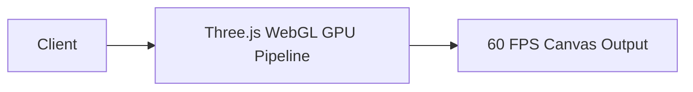

# 14.12: Search And Ai Architecture

## 1. Overview & Context in Gourmet Restaurant
This module analyzes `search-and-ai-architecture` applied specifically to the 3D-accelerated React 19 platform.

## 2. Technical Evaluation & Comparison
| Strategy / Choice | Chosen Implementation | Alternative A | Alternative B | Trade-Off Accepted |
|---|---|---|---|---|
| **3D Rendering** | React Three Fiber (R3F) | Raw Imperative Three.js | Static 2D Photography | GPU memory consumption accepted over static flat imagery. |
| **Motion Physics** | GSAP Vector Attraction | CSS Transitions | React Spring | Direct mouse vector physics accuracy accepted over pure CSS. |

## 3. Spoken 30-Second Interview Response
> "In the Gourmet Restaurant Hub, search and ai architecture balances cutting-edge 3D WebGL immersion with client performance. By encapsulating Three.js inside React Three Fiber and delegating animations to GPU compositor threads, the application delivers fluid 60 FPS interactions across modern devices."
