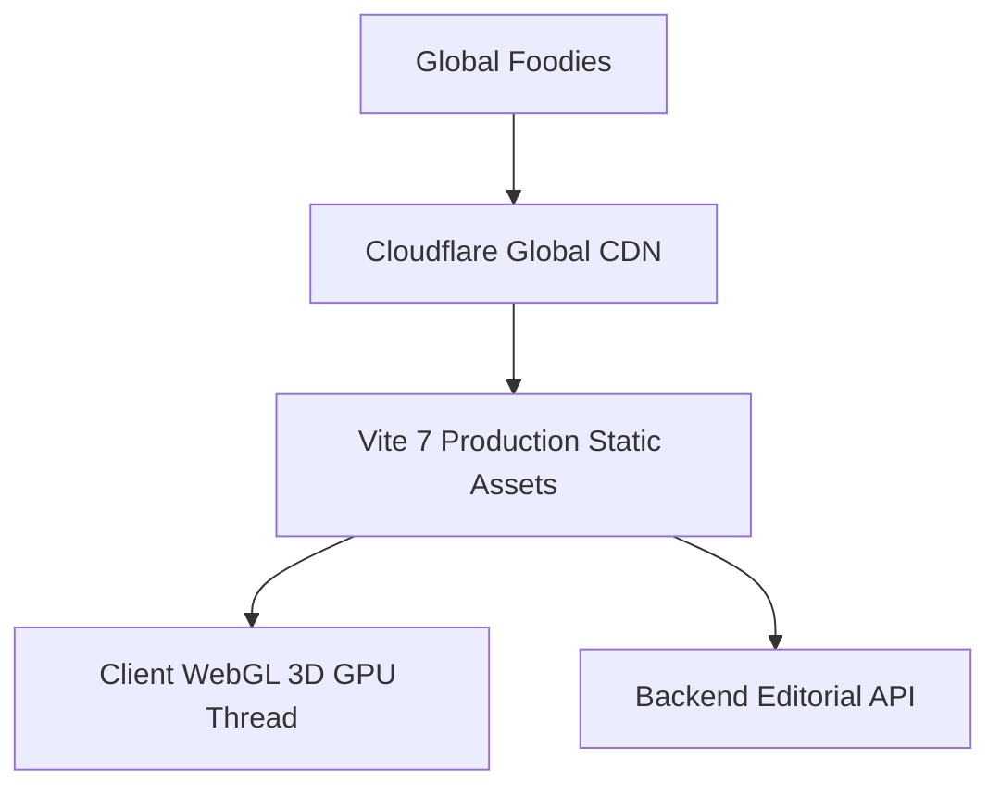

# System Design & Scalability: Gourmet Restaurant Hub

This section analyzes the architecture of high-traffic interactive 3D media applications, CDN streaming, and WebGL asset optimization.

### Module Index
- [14.1 Requirements & Capacity Estimation](/system-design/14.1-requirements-and-estimation)
- [14.2 Architecture Styles](/system-design/14.2-architecture-styles)
- [14.3 Networking & Protocols](/system-design/14.3-networking-and-communication)
- [14.4 Load Balancing & Scaling](/system-design/14.4-load-balancing-and-scaling)
- [14.5 Databases & Storage](/system-design/14.5-databases-and-storage)
- [14.6 Caching Strategies](/system-design/14.6-caching)
- [14.7 Messaging & Queues](/system-design/14.7-messaging-and-queues)
- [14.8 Consistency & Concurrency](/system-design/14.8-consistency-and-concurrency)
- [14.9 Reliability & Resilience](/system-design/14.9-reliability-and-resilience)
- [14.10 API Rate Limiting](/system-design/14.10-api-design-and-rate-limiting)
- [14.11 Security Architecture](/system-design/14.11-security-architecture)
- [14.12 Search & AI Architecture](/system-design/14.12-search-and-ai-architecture)
- [14.13 Real-Time Systems](/system-design/14.13-real-time-systems)
- [14.14 Observability & Ops](/system-design/14.14-observability-and-operations)
- [14.15 Performance Engineering](/system-design/14.15-performance-engineering)
- [14.16 Cost & Trade-Offs](/system-design/14.16-cost-and-trade-offs)
- [14.17 Classic System Designs](/system-design/14.17-classic-system-design)
- [Architectural Decision Records (ADRs)](/system-design/decisions)
